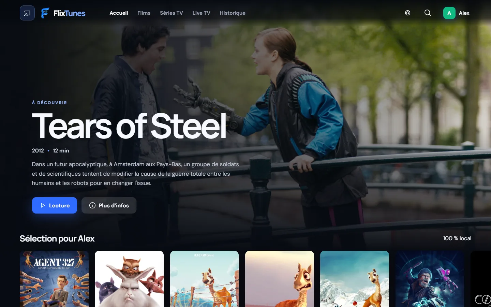
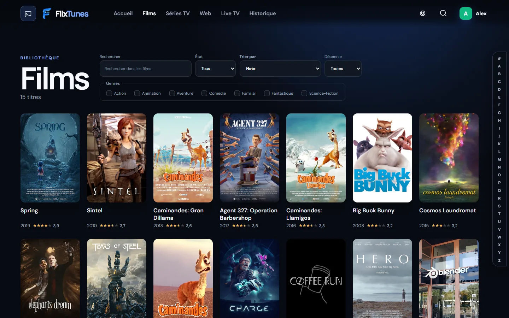
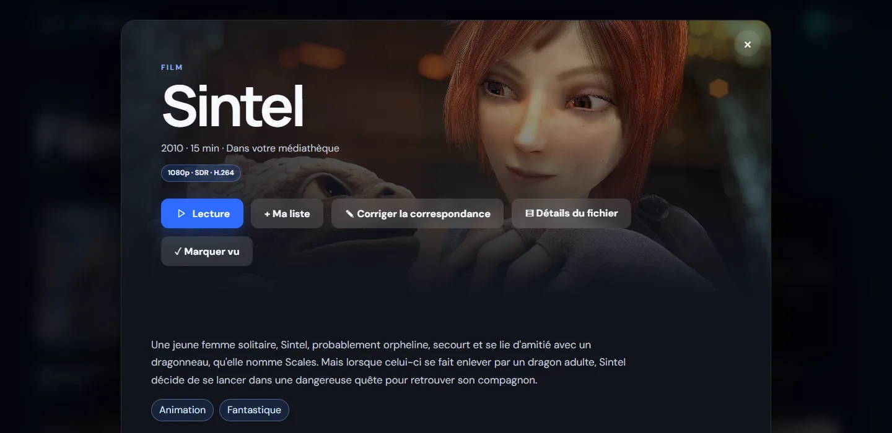
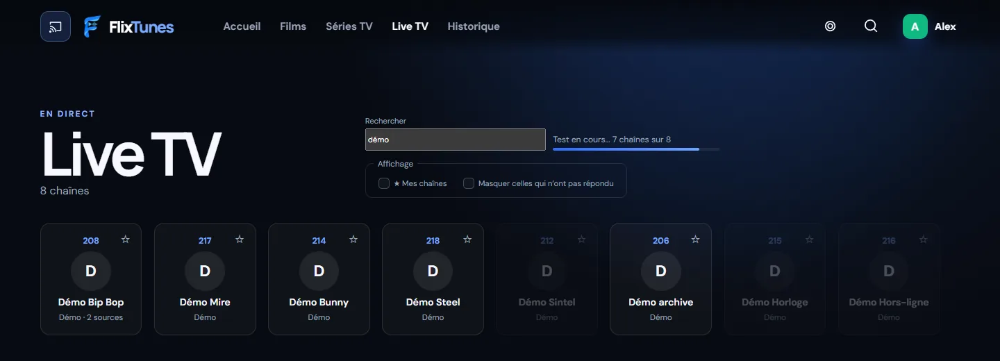
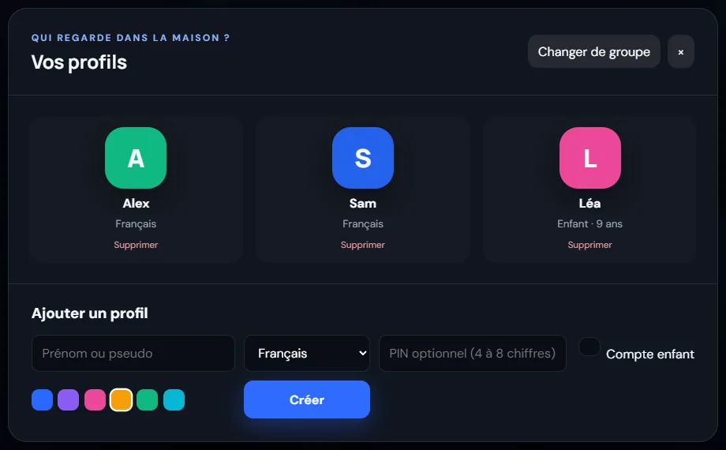
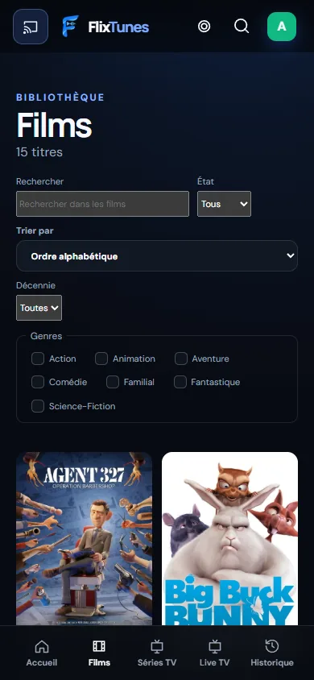

# FlixTunes 0.6.0

FlixTunes est un serveur multimédia à installer chez soi, sur un NAS ou n'importe quelle machine qui
reste allumée. Il catalogue vos films et vos séries, récupère les affiches et les résumés, et les sert
à toute la maison : dans un navigateur, sur un téléphone ou une tablette Android, sur un téléviseur
Android TV, ou depuis l'application de bureau pour Windows et Linux. Il fait aussi la télévision en
direct à partir de listes M3U.

Vos fichiers ne bougent pas. Le serveur ne renomme rien, ne déplace rien : il lit vos dossiers tels
qu'ils sont. Tout tourne dans un seul processus Node avec une base SQLite, sans service extérieur
obligatoire et sans compte à créer ailleurs que chez vous.



## La médiathèque

Vous indiquez un dossier, son type (films, séries, ou détection automatique) et la langue des fiches.
FlixTunes parcourt le dossier, reconnaît les rangements habituels (`Titre (2024)`, `S01E02`, `1x02`,
des sous-dossiers `Saison 1`, les épisodes doubles) et lit chaque fichier avec FFprobe pour connaître
ses pistes, sa définition, ses langues et ses chapitres. Les analyses suivantes ne relisent que ce qui
a changé.

Avec un jeton TMDB, chaque titre reçoit son affiche, son fond, son résumé, sa distribution et ses
genres, en français quand ils existent, en anglais sinon. Les images sont téléchargées une fois par le
serveur ; les clients ne parlent jamais à TMDB. Sans jeton, le catalogue se construit quand même, à
partir des noms de fichiers et des métadonnées embarquées.



Quand une correspondance est fausse, elle se corrige à la main depuis la fiche. Le choix est
verrouillé et passe avant toutes les analyses suivantes, sans toucher au fichier.



## La lecture

Chaque client dit au serveur ce qu'il sait lire, et le serveur choisit la voie la moins coûteuse. Le
plus souvent, le fichier part tel quel (lecture directe, avec reprise à n'importe quel point). Si seul
le conteneur ou la piste son pose problème, il est réemballé à la volée. Ce n'est qu'en dernier
recours qu'il est converti, avec l'accélération matérielle disponible (NVENC, Quick Sync, VA-API, AMF
ou V4L2) et un repli logiciel si elle échoue.

La couleur est traitée avec soin : un film HDR reste HDR quand l'écran suit, et s'il faut le ramener
en SDR, la perte est annoncée avant le début de la lecture, pas découverte en cours de route.

Le reste est ce qu'on attend d'un lecteur : choix des pistes audio et des sous-titres, préférences de
langue par profil, reprise là où on s'était arrêté, épisode suivant enchaîné, minuteur. Le saut des
génériques existe aussi ; il repère le thème d'ouverture d'une série à son empreinte sonore. Comme il
coûte du calcul, il est désactivé par défaut et ne tourne qu'en arrière-plan, quand personne ne
regarde rien.

## La télévision en direct

FlixTunes importe des listes M3U, qu'elles viennent d'un fichier, d'un portail Xtream ou d'une adresse
publique. Les doublons sont fusionnés : une chaîne présente dans plusieurs listes devient une seule
carte avec plusieurs sources. Les chaînes sont rangées par pays, les françaises en tête, avec une
numérotation qui ne change pas d'un jour à l'autre.

Chaque lecture compte. Une source qui coupe recule dans le classement, une source qui tient remonte,
et si l'image cale, le lecteur passe à une autre source de la même chaîne sans quitter le direct.
Depuis la 0.6.0 r12, la lecture reste toujours à vitesse normale : plus d'accélérations discrètes pour
rattraper le direct, qui finissaient par se voir. Sur Android TV, l'écran passe à 50 Hz pour une
chaîne française.

Pendant une recherche, un bouton permet de ne garder que les chaînes qui jouent vraiment, à l'instant.
Le serveur va jusqu'à télécharger le début d'un segment vidéo de chaque chaîne trouvée ; celles qui
ne répondent pas s'estompent pendant le test, puis disparaissent. Le filtre s'efface à la recherche
suivante.



## Sur le téléviseur

Un film ou une chaîne peut être envoyé vers un Chromecast, un téléviseur Google TV ou un téléviseur
DLNA, depuis l'application Android ou depuis Chrome. Sur iPhone et Mac, Safari passe par AirPlay. Le
serveur choisit la qualité selon ce que l'écran accepte vraiment, et l'application garde une
télécommande à l'écran (pause, avance, volume) le temps de la diffusion.

Ça marche aussi hors de chez soi : chez un proche, le téléphone fait le relais entre son téléviseur
et votre serveur, qu'il s'agisse d'un Chromecast ou d'un téléviseur DLNA.

## Profils

Un même serveur peut accueillir plusieurs foyers. Chaque groupe a ses profils, et chaque profil son
historique, sa liste, ses langues, ses réglages de son et, s'il le souhaite, un code. Un profil enfant
porte un âge : ce qui dépasse sa classification n'est jamais envoyé à son appareil, le tri se fait sur
le serveur.



## Les applications



Le client Web s'installe comme une application (PWA) et s'utilise aussi bien à la souris qu'au doigt
ou à la télécommande. C'est lui qui sert de référence pour tout le reste.

L'application Android est la même sur téléphone, tablette et téléviseur : elle s'adapte à l'écran, se
pilote au pavé directionnel sur Android TV et trouve toute seule le serveur sur le réseau local.

L'application de bureau, pour Windows et Linux, reprend l'interface du client Web et confie la lecture
à un VLC embarqué. Un fichier que le navigateur refuserait se lit donc sans que le serveur ait à le
convertir.

Hors de la maison, l'accès distant passe par un proxy HTTPS devant le serveur, avec des comptes
dédiés et un journal des accès. Tant qu'il n'est pas réglé, le serveur ne répond que sur le réseau
local.

<br clear="right">

## Côté serveur

Le serveur mesure ce que la machine sait faire au lieu de le supposer. Au premier démarrage, chaque
accélérateur vidéo est essayé sur un petit banc ; il n'est gardé que s'il va au moins aux quatre
cinquièmes de la vitesse du processeur. Un pilote présent mais lent est écarté. Le résultat est gardé
et refait quand FFmpeg change.

Chaque lecture a un coût estimé. Une lecture directe ne coûte rien et n'est jamais refusée ; quand la
machine approche de sa limite, une définition plus basse est proposée avant tout refus, et un refus
dit pourquoi. Les analyses et les travaux de fond s'effacent devant les lectures et reprennent après,
là où ils en étaient.

On y trouve aussi les sauvegardes de la base et leur restauration, un inventaire des médias, des
métriques et un écran de diagnostic.

## Installer et lancer

Pour un serveur, tout est dans [SERVER_INSTALLATION.md](docs/SERVER_INSTALLATION.md) : Windows, Linux,
NAS ASUSTOR, Docker, et la mise à jour sans perte de données. Le déploiement Docker sur NAS a sa propre
page, [NAS_DEPLOYMENT.md](docs/NAS_DEPLOYMENT.md). Les paquets de chaque version sont publiés dans les
[releases](https://github.com/rodrigueantunes/flixtunes/releases).

Pour développer, il faut Node.js 24 ou plus récent, pnpm 11 et FFmpeg dans le `PATH` :

```powershell
Copy-Item .env.example .env
pnpm install
pnpm dev
```

L'interface répond alors sur `http://localhost:5173` et l'API sur `http://localhost:4000`. En
production, le serveur sert les deux sur le port 4000.

Sous Windows, gardez `node_modules` sur un disque local. Sur un partage réseau, les milliers de petits
fichiers rendent l'installation très lente et certains liens de l'espace de travail sont refusés.

Au premier lancement, un assistant demande au moins une bibliothèque : un nom, un dossier, un type et
une langue. Ensuite, chaque démarrage relance une analyse en arrière-plan, sans rendre le serveur
indisponible. Le jeton TMDB se règle dans l'interface ou par `TMDB_ACCESS_TOKEN` dans `.env`.

Quelques rangements reconnus :

```text
Films/Arrival (2016)/Arrival.2016.1080p.mkv
Series/Severance/Saison 01/Severance.S01E01.mkv
Series/Severance/S02E03 - Titre.mkv
```

## Construire, tester, publier

```powershell
pnpm test                                     # les tests de tous les paquets
pnpm --filter @flixtunes/server test:ffmpeg   # lecture directe, réemballage et conversion sur un vrai fichier
.\tools\Build-Release.ps1                     # une livraison complète dans artifacts/
.\tools\Publier-Release.ps1 -Brouillon        # le brouillon de la release GitHub
```

Le numéro de version vient de la première entrée du [CHANGELOG](CHANGELOG.md), et la construction
refuse de partir s'il ne correspond pas à `package.json`. Elle relance les tests de tous les clients et
donne le même numéro à chaque paquet : APK Android, installeurs de bureau, paquet ASUSTOR, sources pour
NAS et empreintes SHA-256. `tools/Sync-Version.ps1` reporte la version partout où elle apparaît, et un
test échoue si l'un des fichiers prend du retard.

La publication est un geste à part. Le script vérifie que le commit est bien sur GitHub avant
d'envoyer quoi que ce soit, et reprend comme description le passage de l'entrée du journal prévu pour
ça.

## Documentation

- [ARCHITECTURE.md](docs/ARCHITECTURE.md) : comment les morceaux s'articulent
- [CODEC_MATRIX.md](docs/CODEC_MATRIX.md) : ce que chaque client sait lire
- [SECURITY.md](docs/SECURITY.md) : exposition, comptes distants, surface d'attaque
- [ROADMAP.md](docs/ROADMAP.md) : la suite
- [CHANGELOG.md](CHANGELOG.md) : ce qui a changé à chaque version, et pourquoi

Les choix importants ont souvent leur propre page dans `docs/`, avec les mesures qui les ont motivés.

## Licence

FlixTunes est sous licence GPL v3. Le VLC embarqué dans l'application de bureau reste sous GPL v2 ou
ultérieure, et sa licence l'accompagne. Le logo et le son de démarrage ont été faits pour FlixTunes.

Les captures d'écran montrent une médiathèque de démonstration composée des films libres de la
Blender Foundation (Big Buck Bunny, Sintel, Tears of Steel, Spring et les autres), diffusés sous
licence [Creative Commons Attribution](https://creativecommons.org/licenses/by/4.0/), © Blender
Foundation, [studio.blender.org](https://studio.blender.org). Les profils sont fictifs, et les chaînes
du direct sont des flux de test publics. Les affiches et les résumés sont fournis par
[TMDB](https://www.themoviedb.org) ; FlixTunes utilise l'API de TMDB sans être approuvé ni certifié
par TMDB.
